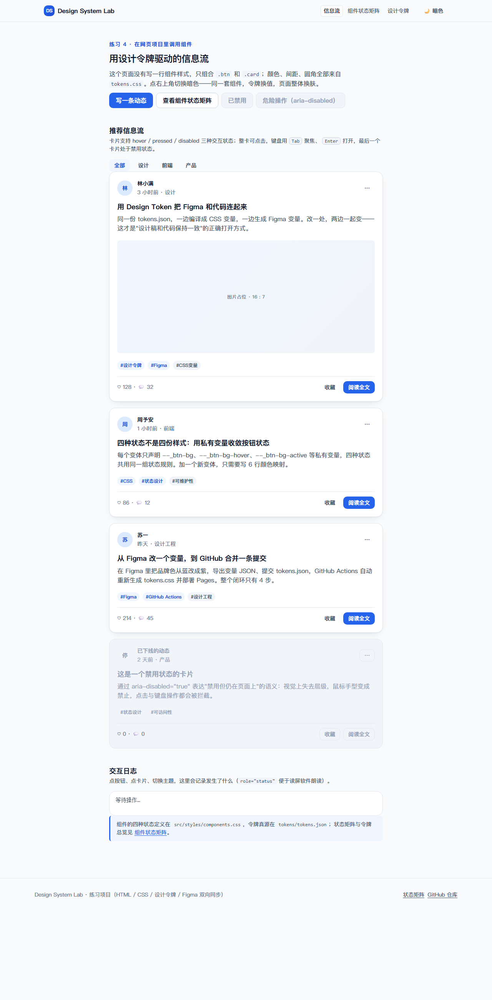
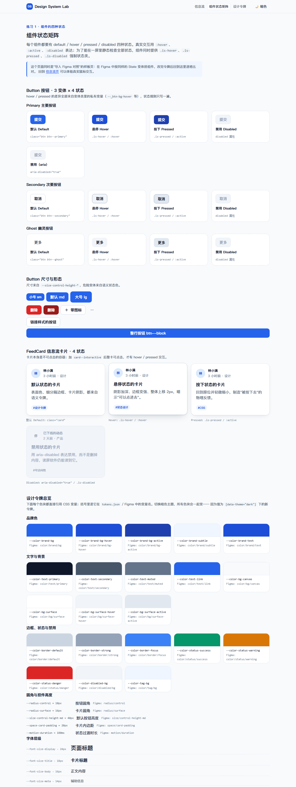
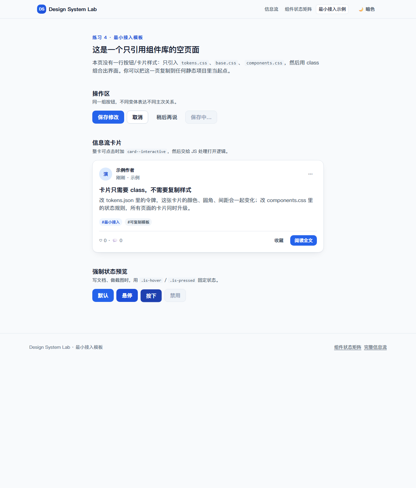

# Design System Lab

> 一个零依赖的练习项目：用 HTML/CSS 手写 **Button + FeedCard 四种状态**，把组件**上传 GitHub**，
> 通过 **tokens.json 让 Figma 与代码共用同一套设计令牌**，并把 Figma 里的令牌修改**回传 GitHub**，
> 最后在一个真实网页项目里调用这套组件。



| 组件状态矩阵 | 最小接入模板 |
| --- | --- |
|  |  |

---

## 这个项目对应你的四个目标

| 你的目标 | 在本项目中的实现 | 关键文件 |
| --- | --- | --- |
| 1. 制作按钮 + 信息流卡片组件，各有 default / hover / pressed / disabled | 4 个按钮变体 + 3 种尺寸 + 卡片交互态，全部四状态 | `src/styles/components.css`、`src/states.html` |
| 2. 把前端组件上传到 GitHub | 完整 Git 流程 + Actions 自动构建/部署 + GitHub Pages 上线 | `docs/03-Git与GitHub.md`、`.github/workflows/` |
| 3. 在 Figma 看到组件，token 一致，Figma 修改能传回 GitHub | `tokens.json` 唯一真源；插件生成 Figma 变量与组件集；导出变量 JSON 回传仓库 | `figma/plugin/`、`docs/04-Figma同步.md`、`tokens/tokens.json` |
| 4. 在网页项目中调用组件 | 信息流页面 + 最小接入模板，页面不写组件样式 | `src/index.html`、`src/demo.html`、`docs/05-接入网页.md` |

---

## 快速开始（3 条命令）

```powershell
cd "C:\Users\Administrator\Desktop\deepseek harness练习\全栈练习\design-system-lab"
node scripts/build-tokens.mjs
npm run dev
```

然后打开 <http://localhost:4173/>：

- `/` 信息流页面（练习 4：在网页里调用组件）
- `/states.html` 组件状态矩阵（练习 1：四状态逐格检查 + 令牌总览）
- `/demo.html` 最小接入模板（练习 4：从零接入的复制起点）
- `/states.html?theme=dark` 强制暗色（截图/导入 Figma 用）

> 没有 Node？本项目零 npm 依赖，但需要 Node 来编译令牌和起本地服务器（见 `docs/00-路线图.md` 第 4 节）。

---

## 目录结构

```
design-system-lab/
├─ tokens/
│  └─ tokens.json              # 设计令牌唯一真源（core / semantic / dark 三层）
├─ scripts/
│  ├─ build-tokens.mjs         # 令牌编译器：tokens.json → src/styles/tokens.css（含校验）
│  ├─ serve.mjs                # 零依赖本地静态服务器
│  └─ bootstrap.ps1            # 一键初始化 git 仓库并推送（可选）
├─ src/
│  ├─ index.html               # 信息流页面（练习 4）
│  ├─ states.html              # 组件状态矩阵 + 令牌总览（练习 1）
│  ├─ demo.html                # 最小接入模板（练习 4）
│  ├─ app.js                   # 主题切换 / 筛选 / 交互日志（最小 JS）
│  └─ styles/
│     ├─ tokens.css            # 自动生成，勿手改
│     ├─ base.css              # reset + 版式 + 布局
│     └─ components.css        # Button / Tag / Avatar / FeedCard（四状态）
├─ figma/
│  ├─ plugin/                  # Figma 本地插件：生成变量与组件集、导出变量 JSON
│  └─ README.md                # 插件安装与运行说明
├─ .github/workflows/
│  ├─ build-tokens.yml         # 令牌变更 → 重新生成 tokens.css 并提交
│  └─ deploy-pages.yml         # 构建令牌 → 部署 src/ 到 GitHub Pages
├─ docs/                       # 6 篇分阶段教程（见下表）
├─ assets/                     # 页面预览图
├─ .gitattributes              # 统一 LF 换行，避免 CI 假 diff
├─ .gitignore
├─ package.json                # 零依赖，只有 scripts
└─ README.md
```

---

## 学习路线图（按顺序看 docs）

| 阶段 | 文档 | 你会得到 | 预计时间 |
| --- | --- | --- | --- |
| 总览 | [docs/00-路线图.md](docs/00-路线图.md) | 全局心智模型 + 每个阶段的验收标准 | 先读 10 分钟 |
| 1 | [docs/01-设计令牌.md](docs/01-设计令牌.md) | 看懂/会改/会加 token，改一次全站变色 | 60~90 min |
| 2 | [docs/02-组件实现.md](docs/02-组件实现.md) | 能独立解释并手写四状态组件 | 2~3 h |
| 3 | [docs/03-Git与GitHub.md](docs/03-Git与GitHub.md) | 仓库上线、Actions 全绿、PR 流程 | 60~90 min |
| 4 | [docs/04-Figma同步.md](docs/04-Figma同步.md) | Figma 变量 + 组件集 + 双向同步闭环 | 1.5~2 h |
| 5 | [docs/05-接入网页.md](docs/05-接入网页.md) | 新页面零复制接入组件 | 45~60 min |
| 6 | [docs/06-进阶与排错.md](docs/06-进阶与排错.md) | 排错速查 + 进阶路线 + 自测题 | 按需 |

---

## 设计决策（为什么这样写）

1. **`tokens/tokens.json` 是唯一真源**：CSS 由 `build-tokens.mjs` 生成，Figma 由插件读取同一份 JSON。任何一边手写值都会在 CI/走查时暴露。
2. **三层令牌**：`core`（原始值）→ `semantic`（用途）→ `dark`（主题覆盖）。组件只用语义令牌，暗色只覆盖令牌，不复制组件样式。
3. **命名规则统一**：Figma 变量 `color/bg/canvas` ⇔ CSS `--color-bg-canvas`（`/` 换 `-`，加 `--`）。
4. **四状态用"私有变量 + 状态规则只写一次"**：变体只映射 `--_btn-bg` 等变量；真实交互用伪类，静态检查用 `.is-hover` / `.is-pressed` 强制类。
5. **禁用态写在最后**：避免被 hover/pressed 覆盖；`:disabled` 与 `aria-disabled` 明确区分。
6. **编译期校验**：拼错 token 变量名、引用不存在、变量重名、暗色缺少默认值，都会让 `npm run tokens` 直接失败。
7. **零依赖**：没有 node_modules、没有构建工具，clone 下来就能读、能跑、能改。

---

## 常用命令

```powershell
node scripts/build-tokens.mjs          # 生成 src/styles/tokens.css
node scripts/build-tokens.mjs --check  # 只校验（PR/CI 用，过期则失败）
npm run dev                            # 本地预览 http://localhost:4173
npm run tokens                         # 同 build-tokens
pwsh -File scripts/bootstrap.ps1       # 首次初始化 git 仓库（可选）
# 没有 PowerShell 7 时用：powershell -NoProfile -ExecutionPolicy Bypass -File scripts\bootstrap.ps1
git add -A; git commit -m "feat: ..."; git push
```

---

## 验收清单（做完打勾）

- [ ] 本地能打开信息流、状态矩阵、最小接入三个页面，暗色正常
- [ ] 改一个 token 并重新生成，页面组件颜色随之变化
- [ ] 按钮三种变体 × 四状态、卡片四状态全部符合预期
- [ ] GitHub 仓库 Actions 全绿，Pages 线上可访问
- [ ] Figma 里有 `Design Tokens` 变量集合与 `Button` / `FeedCard` 组件集
- [ ] 完成过一次"Figma 改变量 → 导出 JSON → 提交 → 线上变化"
- [ ] 新页面只引 3 个 CSS 即可使用组件
- [ ] 能 5 分钟讲清整套数据流

---

## 许可

仅用于学习与练习，可自由修改、复制、用于个人项目。
