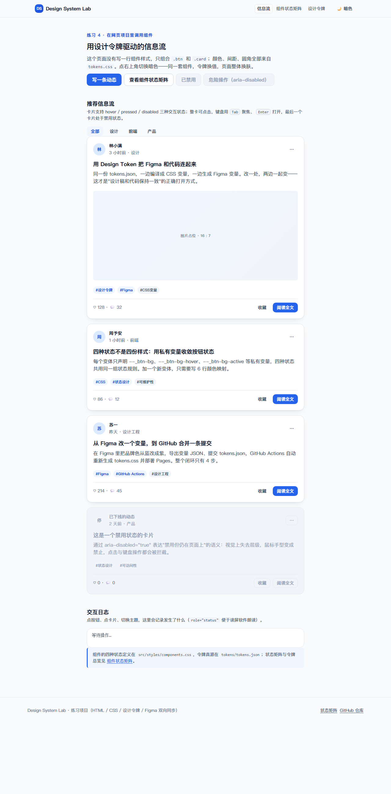
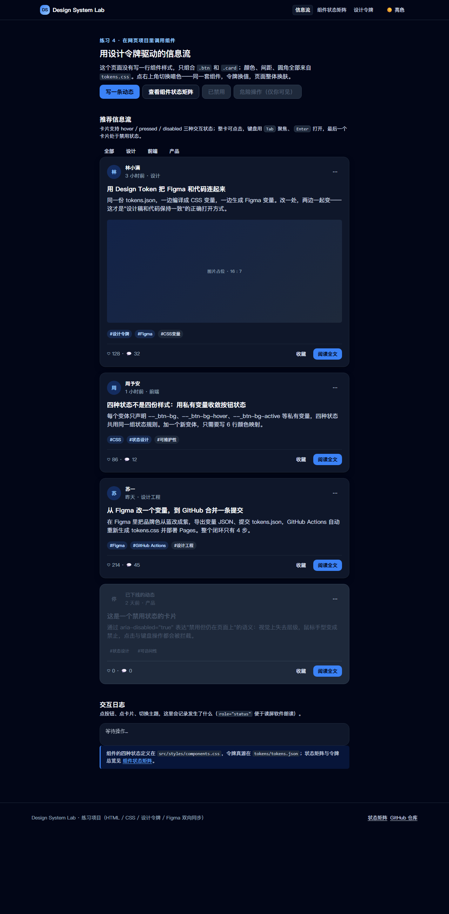

# 从 0 到 1：设计令牌驱动的组件练习路线图

> 目标：用你已有的 HTML/CSS、Git/GitHub、Figma 基础，完整走一遍"**代码组件 ↔ GitHub ↔ Figma 设计系统**"的闭环。
> 全程零 npm 依赖、不需要后端、不需要付费 Figma 功能，所有代码都已在本仓库里，复制即用。

---

## 1. 这套练习会产出什么

| # | 产出 | 在哪看 |
| --- | --- | --- |
| 1 | **Button 按钮组件**：3 个常用变体（primary/secondary/ghost）+ 危险变体（danger），3 种尺寸，每种都有 default / hover / pressed / disabled 四种状态 | `src/styles/components.css` + `src/states.html` |
| 2 | **FeedCard 信息流卡片**：头像、作者、标题、正文、标签、操作区，整卡可点击，同样四种状态 | 同上 |
| 3 | **设计令牌系统**：`tokens/tokens.json` 是唯一真源，自动编译成 CSS 变量，自动带明暗主题 | `tokens/tokens.json` → `src/styles/tokens.css` |
| 4 | **GitHub 仓库 + 自动化**：Actions 自动生成令牌 CSS、自动部署 GitHub Pages | `.github/workflows/` |
| 5 | **Figma 组件库**：用仓库自带插件把令牌生成 Figma 变量、把组件生成 Figma 变体集；改 Figma 变量可以导回 JSON 再回传 GitHub | `figma/plugin/` + `docs/04-Figma同步.md` |
| 6 | **网页项目**：一个真实的信息流页面，只组合组件、不写组件样式，支持暗色主题 | `src/index.html` |

页面效果预览（点击看大图）：

| 亮色信息流 | 暗色信息流 |
| --- | --- |
|  |  |

---

## 2. 适合谁、要花多久

- **适合**：会写基本 HTML/CSS（Flex、class、伪类）、用过 `git add/commit/push`、能在 Figma 里画 Frame 和 Component 的人。
- **不要求**：JavaScript 框架、Node.js 经验、设计系统经验、Figma 插件开发经验。
- **时间**：核心 5 个阶段约 **6~9 小时**，建议拆成 3~4 个半天；进阶阶段按兴趣选做。

| 天数（示例） | 做什么 |
| --- | --- |
| 第 1 天下午 | 阶段 0 + 阶段 1（跑起来、吃透令牌） |
| 第 2 天上午 | 阶段 2（组件与四状态，最重要） |
| 第 2 天下午 | 阶段 3（GitHub + Actions + Pages） |
| 第 3 天上午 | 阶段 4（Figma 双向同步） |
| 第 3 天下午 | 阶段 5 + 阶段 6（接入网页、进阶） |

---

## 3. 先建立核心心智模型（比敲代码更重要）

```
                 ┌──────────────────────────────┐
                 │   tokens/tokens.json         │  ← 唯一真源（single source of truth）
                 │   core / semantic / dark     │
                 └───────┬───────────────┬──────┘
                         │               │
        node scripts/build-tokens.mjs    │  Figma 插件读同一份 JSON
                         │               │
                         ▼               ▼
              tokens.css（CSS 变量）   Figma 变量（color/bg/canvas …）
                         │               │
                         ▼               ▼
              components.css（组件）   Figma Button / FeedCard 组件变体
                         │               │
                         ▼               │
              index.html（网页调用）      │
                         │               │
                 GitHub Actions ◄────────┘ 把 Figma 里改的变量 JSON 导回仓库
                         │
                         ▼
                 GitHub Pages（线上可访问）
```

三条必须记住的规则：

1. **组件只吃"语义令牌"**：按钮背景写 `var(--color-brand-bg)`，绝不写 `#2563eb`。
2. **一份令牌两处消费**：CSS 由 `build-tokens.mjs` 生成，Figma 由插件生成，命名靠同一条规则对齐：
   - Figma 变量名：`color/bg/canvas`
   - CSS 变量名：`--color-bg-canvas`（把 `/` 换成 `-`，前面加 `--`）
3. **状态是"规则"不是"四份样式"**：真实交互用 `:hover/:active/:disabled`，静态检查用 `.is-hover/.is-pressed/.is-disabled` 强制类。

---

## 4. 开始之前：环境清单

| 工具 | 版本要求 | 检查命令 | 用途 |
| --- | --- | --- | --- |
| Node.js | ≥ 18（本项目零依赖，只需 node） | `node --version` | 编译令牌、本地服务器 |
| Git | 任意新版本 | `git --version` | 版本管理 |
| VS Code（推荐） | 任意 | — | 编辑代码 |
| 浏览器 | Chrome / Edge 新版 | — | 看页面 |
| Figma 账号 | 免费 Starter 即可 | — | 阶段 4、5 用 |
| **Figma 桌面版** | 任意 | — | 运行本地开发插件（浏览器版不支持） |
| GitHub 账号 | 免费即可 | — | 阶段 3~5 |

一次性 Git 配置（只做一次）：

```powershell
git config --global user.name "你的名字"
git config --global user.email "你的邮箱@example.com"
git config --global init.defaultBranch main
```

> 建议先安装 Node 再继续；装好后**关掉并重开终端**，否则 `node` 可能还不在 PATH 里。

---

## 5. 学习路线图总览

| 阶段 | 你要做什么 | 主要产出 | 预计 | 详细指引 |
| --- | --- | --- | --- | --- |
| 0 | 把项目跑起来 | 本地能看到两个页面 | 30 min | 本文件第 6 节 |
| 1 | 吃透设计令牌 | 改一个 token 全站变色 | 60~90 min | [01-设计令牌.md](./01-设计令牌.md) |
| 2 | 组件与四种状态（核心） | 能讲清每个状态怎么写、覆盖顺序为什么这样 | 2~3 h | [02-组件实现.md](./02-组件实现.md) |
| 3 | Git + GitHub 上线 | 仓库、Actions 全绿、Pages 可访问 | 60~90 min | [03-Git与GitHub.md](./03-Git与GitHub.md) |
| 4 | Figma 双向同步 | Figma 里有变量 + 组件集；改变量能回到仓库 | 1.5~2 h | [04-Figma同步.md](./04-Figma同步.md) |
| 5 | 在网页项目里调用组件 | 信息流页 + 新页面模板 | 45~60 min | [05-接入网页.md](./05-接入网页.md) |
| 6 | 进阶与排错 | 按兴趣扩展 | 选做 | [06-进阶与排错.md](./06-进阶与排错.md) |

---

## 6. 阶段 0：把项目跑起来（30 分钟）

### 0.1 打开项目

```powershell
# 进入项目目录（改成你自己的路径）
cd "C:\Users\Administrator\Desktop\deepseek harness练习\全栈练习\design-system-lab"

# 生成 CSS 令牌（第一次必须执行，src/styles/tokens.css 是生成物）
node scripts/build-tokens.mjs
```

**验收**：终端输出类似

```
✅ 已生成 src\styles\tokens.css
   token 总数：172（core 75 / semantic 67 / dark 30）
   CSS 变量：142 个；被组件使用：71 个
```

> 如果提示 `node 不是内部或外部命令`：Node 没装好或没重开终端。回到第 4 节。

### 0.2 启动本地服务器

```powershell
npm run dev
# 等价于 node scripts/serve.mjs，也可以用 python -m http.server 8000 -d src
```

打开浏览器访问：

- 信息流页面：<http://localhost:4173/>
- 组件状态矩阵：<http://localhost:4173/states.html>
- 暗色版本：<http://localhost:4173/states.html?theme=dark>（`?theme=dark` 是给截图/导入 Figma 用的强制主题参数）

### 0.3 第一次浏览要看的 5 个点

1. 点右上角 **🌙 暗色**，整页换肤，但组件结构完全不变。
2. 在 `states.html` 里看到按钮三种变体 × 四种状态全部并排展示（靠 `.is-hover` 等强制类）。
3. 鼠标划过信息流卡片（`index.html`），卡片上浮、阴影加深；按住时回落缩小。
4. 最后一张卡片是禁用状态：变成灰色、光标变禁止、点它只会写一条"被拦截"日志。
5. `Tab` 键能依次聚焦按钮和卡片，出现蓝色焦点环。

**验收**：以上 5 点全部成立，说明环境 OK。修不好就翻 [06-进阶与排错.md](./06-进阶与排错.md) 的"排错速查表"。

---

## 7. 阶段 1：设计令牌（60~90 分钟）

> 完整讲解见 [01-设计令牌.md](./01-设计令牌.md)，这里只给操作顺序。

1. 打开 `tokens/tokens.json`，先看懂三层：`core`（原始值，如 `color.blue.600`）→ `semantic`（语义，如 `color.brand.bg`）→ `dark`（主题覆盖）。
2. 读 `scripts/build-tokens.mjs` 顶部注释，理解命名规则和编译流程。
3. 跑 `npm run tokens`，打开 `src/styles/tokens.css`，随便搜一个 `--color-brand-bg`，找到它来自哪个 token。
4. **动手改一次**：把品牌主色换成紫色系。

   ```powershell
   # 在 tokens.json 里把 core.color.blue.600 改成 #7c3aed（或用编辑器改）
   # 然后重新生成
   npm run tokens
   ```

   **验收**：刷新页面，按钮、选中标签、链接色一起变成紫色——你只改了一个原始值。

5. 再改回来，或者继续加一个 token（练习见 01 文档末尾）。

**阶段验收**（能不看文档回答）：

- [ ] 为什么组件里不能直接写 `#2563eb`？
- [ ] `--color-brand-bg` 是由哪条 token 路径生成的？对应 Figma 变量叫什么？
- [ ] `core` 和 `semantic` 的区别是什么？为什么暗色只需要覆盖 `dark` 这一层？

---

## 8. 阶段 2：组件与四种状态（2~3 小时，核心阶段）

> 完整讲解见 [02-组件实现.md](./02-组件实现.md)。

1. 先只读 `src/styles/components.css` 的 Button 部分，回答：为什么每个变体只需要 6~8 行？
2. 读四种状态的实现，重点是**顺序**：真实 hover → 真实 active → 强制 hover/pressed → disabled 最后。想明白"为什么 disabled 必须最后写"。
3. 打开 `src/states.html`，逐格核对：primary/secondary/ghost × default/hover/pressed/disabled。
4. 自己加一个变体（选做）：`btn--success`（成功按钮），只用语义令牌里的 `--color-status-success` 及其 hover/active。提示：先把 `status/success-hover`、`status/success-active` 两个 token 加进 `tokens.json`。
5. 动手写卡片：新增一个"紧凑卡片"变体 `card--compact`（内边距更小、隐藏媒体区、标题字号降一级）。要求仍然只用语义令牌。

**阶段验收**：

- [ ] 不看书能说出按钮四状态在 CSS 里分别由哪些选择器控制
- [ ] 能解释 `.btn:disabled` 和 `.btn[aria-disabled="true"]` 的区别（原生禁用 vs 可聚焦的"逻辑禁用"）
- [ ] 状态矩阵页每一格都符合预期，暗色模式下也符合

---

## 9. 阶段 3：Git 与 GitHub（60~90 分钟）

> 完整讲解见 [03-Git与GitHub.md](./03-Git与GitHub.md)。

```powershell
# 一键初始化本地仓库（推荐）
pwsh -File scripts/bootstrap.ps1
```

然后：

1. 在 GitHub 上新建空仓库 `design-system-lab`（Public，不要勾选 README）。
2. 关联远程并推送：

   ```powershell
   git remote add origin https://github.com/<你的用户名>/design-system-lab.git
   git push -u origin main
   ```

3. 仓库 **Settings → Pages → Build and deployment → Source** 选择 **GitHub Actions**。
4. 打开 **Actions** 页，看到 `Deploy to GitHub Pages` 运行成功，访问 `https://<你的用户名>.github.io/design-system-lab/`。
5. 顺手练一次 PR：新建分支 → 改点东西 → 推送 → 开 PR → 合并 → 回本地 `git switch main; git pull`。

**阶段验收**：

- [ ] Actions 两个工作流都能跑通（令牌构建 + Pages 部署）
- [ ] 线上网址能打开信息流页和状态矩阵页
- [ ] 本地改 `tokens.json` 并推送后，线上页面颜色会跟着变
- [ ] 会看 Actions 日志定位失败步骤

---

## 10. 阶段 4：Figma 双向同步（1.5~2 小时）

> 完整讲解见 [04-Figma同步.md](./04-Figma同步.md)。核心思路：

1. **Figma 看到组件**：仓库带一个 Figma 本地插件（`figma/plugin/`），运行后能自动创建：
   - 一个 `Design Tokens` 变量集合（变量名 = `color/bg/canvas` 这种格式）
   - `Button` 组件集（Variant × State 共 12 个变体）
   - `FeedCard` 组件集（State 共 4 个变体）
2. **Token 一致**：插件不是"再写一份色值"，而是**读同一份 `tokens/tokens.json`**；改 Figma 变量 → 用插件把变量导出成 JSON → 覆盖仓库 `tokens/tokens.json` → GitHub Actions 自动重建 CSS → 页面/组件外观更新。
3. **闭环验证**：在 Figma 里把 `color/brand/bg` 改成紫色 → 导出 → 提交 → 等 Actions → 刷新线上页面，按钮变紫。

**阶段验收**：

- [ ] Figma 里能看到 `color/bg/canvas` 等变量，且值来自 `tokens.json`
- [ ] `Button` 组件集有 Variant 和 State 两个属性，共 12 个变体
- [ ] 改 Figma 变量并导回仓库后，CSS 变量和线上页面同步变化
- [ ] 能说清"为什么布局/结构改动不能自动同步"（tokens 能自动，结构需要人写或 Code Connect）

---

## 11. 阶段 5：在网页项目里调用组件（45~60 分钟）

> 完整讲解见 [05-接入网页.md](./05-接入网页.md)。

1. 读 `src/index.html`：整页没有一行按钮/卡片样式，只有 class 组合。
2. 用 05 文档里的"最小页面模板"新建 `src/demo.html`，放一个按钮 + 一张卡片，验收样式一致。
3. 试试只改 `data-theme` 切换主题；再用 05 文档里的"覆写令牌"方式做一个"品牌绿"主题。
4. 推送后确认 Pages 上的新页面也能访问。

**阶段验收**：

- [ ] 新页面不复制任何组件 CSS，只引用 3 个样式文件就能用组件
- [ ] 会写 `<button class="btn btn--primary is-hover">` 强制某状态做截图
- [ ] 明白 `:root` 覆写令牌和改 `tokens.json` 的区别

---

## 12. 阶段 6：进阶（选做）

按兴趣挑 2~3 个做，详见 [06-进阶与排错.md](./06-进阶与排错.md)：

- 给按钮加 **loading 状态**（禁用点击 + spinner + `aria-busy`）
- 把组件做成 **Storybook** 或纯 HTML 的 story 集合
- 用 **Playwright** 做状态截图回归测试
- 用 **Style Dictionary** 把 token 编译到 iOS/Android/SCSS
- 给组件加 **Code Connect**，让 Figma Dev Mode 直接显示真实代码片段
- 把组件发布成内部 npm 包

---

## 13. 一键命令速查

```powershell
cd "C:\Users\Administrator\Desktop\deepseek harness练习\全栈练习\design-system-lab"

node scripts/build-tokens.mjs     # 生成 tokens.css
node scripts/build-tokens.mjs --check  # 只校验（CI 用）
npm run dev                       # 本地预览 http://localhost:4173
npm run tokens                    # 同上：生成令牌
pwsh -File scripts/bootstrap.ps1  # 初始化 git 仓库（首次）
# 如果提示"找不到 pwsh"（说明没装 PowerShell 7），改用系统自带版本：
powershell -NoProfile -ExecutionPolicy Bypass -File scripts\bootstrap.ps1
git status / git diff / git add -A / git commit -m "..." / git push
```

---

## 14. 完成度自评（全部打勾才算走完）

- [ ] 能独立解释 tokens.json 的三层结构和命名规则
- [ ] 能不看代码讲清两种组件 × 四种状态的实现方式
- [ ] 能独立新增一个按钮变体，只用语义令牌
- [ ] GitHub 仓库有清晰的提交历史，Actions 全绿
- [ ] GitHub Pages 线上可用，地址能发给别人看
- [ ] Figma 里有变量集合 + 两个组件集，命名与代码一一对应
- [ ] 完成过至少一次"Figma 改变量 → 导出 → 提交 → 线上变化"
- [ ] 能用新页面复用组件，不需要复制组件 CSS
- [ ] 说得清这套方案里"哪些能自动化、哪些必须人工"

---

## 15. 常见误区（提前避雷）

1. **把 Figma 当唯一真源**：Figma 是设计侧入口，但代码仓库里的 `tokens.json` 才是可版本化、可 CI 校验的真源。
2. **组件里写死色值**：一旦写死，改 token 不会生效，"设计系统"就退化成"一套 CSS"。
3. **四种状态各写一份 class**：短期快，长期四份样式到处漂移；用私有变量收敛。
4. **禁用态写在前面**：会被 `:hover` 覆盖，出现"禁用按钮还能变色"的 bug。
5. **只做鼠标状态**：键盘用户需要 `:focus-visible`，读屏用户需要 `aria-*`。
6. **把暗色写成第二套 CSS**：暗色只应覆盖令牌，不应该复制组件样式。
7. **只 push 不建 PR**：PR + CI 是现代协作的基本功，一人项目也要练。
8. **忘记 `tokens.css` 也是代码**：它是生成物，别手改；提交它才能让本地/线上一致。

---

## 16. 时间不够时的最小路径（90 分钟版）

1. 阶段 0 跑起来（15 min）
2. 阶段 1 只做"改一个颜色并刷新"（20 min）
3. 阶段 2 只看按钮四状态 + 状态矩阵对照（30 min）
4. 阶段 3 推到 GitHub 并打开 Pages（25 min）

Figma 同步留到下次——但记住：**没有走完阶段 4，这个练习最重要的"设计↔代码一致"闭环还没闭环。**

---

## 17. 文件地图

| 文件/目录 | 作用 | 对应阶段 |
| --- | --- | --- |
| `tokens/tokens.json` | 设计令牌唯一真源 | 1、4 |
| `scripts/build-tokens.mjs` | 令牌编译器（含校验） | 1 |
| `src/styles/tokens.css` | 生成的 CSS 变量（勿手改） | 1 |
| `src/styles/base.css` | reset + 版式 + 布局 | 2、5 |
| `src/styles/components.css` | Button / Card / Tag / Avatar 四状态 | 2 |
| `src/states.html` | 组件状态矩阵 + 令牌总览 | 2 |
| `src/index.html` | 信息流网页（练习 4） | 5 |
| `src/demo.html` | 最小接入模板（练习 4 的复制起点） | 5 |
| `src/app.js` | 主题切换 / 筛选 / 日志（最小 JS） | 5 |
| `figma/plugin/` | Figma 变量与组件生成插件 | 4 |
| `.github/workflows/` | 令牌自动构建 + Pages 部署 | 3 |
| `docs/01~06` | 各阶段详细教程 | 全部 |

---

下一步：打开 [01-设计令牌.md](./01-设计令牌.md)，开始阶段 1。
