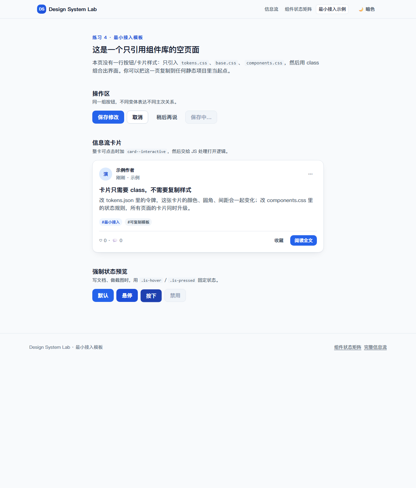

# 05 · 在一个网页项目里调用组件

> 阶段 5 的目标：**新页面不复制任何组件样式，只引用 3 个 CSS 文件就能做出界面。**
> 本文件附带一个可直接复制的最小模板：[src/demo.html](../src/demo.html)（线上预览 `/demo.html`）。

---

## 1. 三种复用方式，怎么选

| 方式 | 适合场景 | 成本 | 缺点 |
| --- | --- | --- | --- |
| **A. 直接引用本仓库的 3 个 CSS** | 学习和单页项目 | 最低 | 组件升级要跟着改引用版本 |
| **B. 复制 `tokens.css` + `base.css` + `components.css` 到新项目** | 新项目起步、不能依赖外链 | 低 | 需要自己同步上游修改 |
| **C. 打包成 npm 包（进阶）** | 多项目、团队协作 | 中 | 需要构建/发版流程，见 06 文档 |

本项目默认走 **A**：页面只写 `<link>`，组件样式永远只有一份。

```html
<!-- 顺序很重要：先令牌，再基础，最后组件 -->
<link rel="stylesheet" href="./styles/tokens.css" />
<link rel="stylesheet" href="./styles/base.css" />
<link rel="stylesheet" href="./styles/components.css" />
```

> 为什么顺序重要：`base.css` 里有 reset（会重置按钮的边框/背景），`components.css` 必须在其后，才能覆盖 reset。令牌变量定义在最前，任何文件都能用。

---

## 2. 最小可用页面模板（可整段复制）

配套示例页：[src/demo.html](../src/demo.html)（线上预览 `/demo.html`），效果如下：



把下面内容存成 `你的项目/index.html`，把 3 个 CSS 放到 `你的项目/styles/`，直接双击打开或用任意静态服务器访问即可：

```html
<!doctype html>
<html lang="zh-CN">
  <head>
    <meta charset="utf-8" />
    <meta name="viewport" content="width=device-width, initial-scale=1" />
    <title>我的页面 · 使用设计系统组件</title>
    <script>
      // 防止暗色用户看到白屏闪烁；支持 ?theme=dark 强制主题
      try {
        var t = new URLSearchParams(location.search).get('theme') || localStorage.getItem('dsl-theme');
        if (t === 'dark' || t === 'light') document.documentElement.dataset.theme = t;
      } catch (e) {}
    </script>
    <link rel="stylesheet" href="./styles/tokens.css" />
    <link rel="stylesheet" href="./styles/base.css" />
    <link rel="stylesheet" href="./styles/components.css" />
  </head>
  <body>
    <main class="page page--narrow">
      <h1 class="page-title">我的页面</h1>

      <div class="row">
        <button class="btn btn--primary" type="button">主要按钮</button>
        <button class="btn btn--secondary" type="button">次要按钮</button>
        <button class="btn btn--ghost" type="button">幽灵按钮</button>
        <button class="btn btn--primary" type="button" disabled>禁用</button>
      </div>

      <article class="card card--interactive" tabindex="0" aria-label="打开卡片：示例">
        <header class="card__header">
          <span class="avatar" aria-hidden="true">样</span>
          <div class="card__meta">
            <span class="card__author">示例作者</span>
            <span class="card__time">刚刚 · 示例</span>
          </div>
        </header>
        <div class="card__body">
          <h2 class="card__title">卡片标题</h2>
          <p class="card__text">这张卡片没有写任何样式，全部来自组件库。</p>
          <ul class="card__tags"><li class="tag">#设计系统</li></ul>
        </div>
        <footer class="card__footer">
          <span class="card__stats">♡ 12 · 💬 3</span>
          <div class="card__actions">
            <button class="btn btn--primary btn--sm" type="button">阅读全文</button>
          </div>
        </footer>
      </article>
    </main>

    <script>
      // 主题切换
      (function () {
        var root = document.documentElement;
        var isDark = root.dataset.theme === 'dark';
        document.querySelectorAll('[data-theme-toggle]').forEach(function (btn) {
          btn.textContent = isDark ? '☀️ 亮色' : '🌙 暗色';
          btn.addEventListener('click', function () {
            var next = root.dataset.theme === 'dark' ? 'light' : 'dark';
            if (next === 'dark') root.dataset.theme = 'dark';
            else delete root.dataset.theme;
            try { localStorage.setItem('dsl-theme', next); } catch (e) {}
            btn.textContent = next === 'dark' ? '☀️ 亮色' : '🌙 暗色';
          });
        });
      })();
    </script>
  </body>
</html>
```

想加主题按钮就在 `<body>` 里放：

```html
<button class="btn btn--ghost btn--sm" type="button" data-theme-toggle aria-pressed="false">🌙 暗色</button>
```

---

## 3. 常用组合场景

### 3.1 表单操作区（主次分明）

```html
<div class="row">
  <button class="btn btn--secondary" type="button">取消</button>
  <button class="btn btn--primary" type="button">保存</button>
</div>
```

规则：**一个区域只放一个 primary**，其余用 secondary/ghost。危险操作用 `btn--danger`，并且配合确认弹窗。

### 3.2 信息流列表

```html
<div class="feed">
  <article class="card">…</article>
  <article class="card">…</article>
</div>
```

`feed` 是 `base.css` 里的布局工具类：纵向排列 + 16px 间距。要让卡片可点击：加 `card--interactive`、`tabindex="0"`、`aria-label`，并参考 `src/app.js` 写点击/键盘逻辑。

### 3.3 空状态 / 提示

```html
<p class="notice">还没有内容，发布第一条动态试试。</p>
```

### 3.4 标签与头像

```html
<span class="avatar avatar--sm" aria-hidden="true">林</span>
<ul class="card__tags">
  <li class="tag">#设计令牌</li>
  <li class="tag tag--muted">#可访问性</li>
</ul>
```

---

## 4. 覆盖令牌做"你自己的主题"

两种做法，用途不同：

### 做法一：改 `tokens.json`（推荐，全局、可同步 Figma）

改完 `npm run tokens`，所有页面、所有组件、Figma 导出都会一致。适合真正的品牌主题。

### 做法二：在页面里覆盖 CSS 变量（快速试验/单页定制）

```html
<style>
  /* 只影响当前页面：把品牌色系换成绿色 */
  :root {
    --color-brand-bg: #059669;
    --color-brand-bg-hover: #047857;
    --color-brand-bg-active: #065f46;
    --color-brand-text: #047857;
    --color-brand-subtle: #ecfdf5;
    --color-brand-muted: #d1fae5;
    --color-border-focus: #10b981;
  }
</style>
```

注意：

- 覆盖必须放在 `tokens.css` **之后**（同优先级后写的赢）。
- 这种覆盖不会进入 Figma，也不会被 CI 校验——只适合试验。
- 暗色下想保留效果，需要在 `[data-theme="dark"]` 里再覆盖一份。

---

## 5. 暗色主题接入的三种层级

| 层级 | 做法 | 适用 |
| --- | --- | --- |
| 手动切换 | 页面按钮改 `document.documentElement.dataset.theme` | 学习、Demo |
| 记住选择 | 再加 `localStorage` + `<head>` 内联脚本防闪烁 | 大多数网站 |
| 跟随系统 | `window.matchMedia('(prefers-color-scheme: dark)')` + 监听变化 | 现代网站（可选加一个"跟随系统"选项） |

跟随系统的扩展示例（可加到 `app.js`）：

```js
const media = window.matchMedia('(prefers-color-scheme: dark)');
const applySystemTheme = () => {
  if (localStorage.getItem('dsl-theme')) return; // 用户手动选过就不跟随
  if (media.matches) document.documentElement.dataset.theme = 'dark';
  else delete document.documentElement.dataset.theme;
};
media.addEventListener('change', applySystemTheme);
applySystemTheme();
```

---

## 6. 在 React / Vue 里怎么用

组件库本质是"CSS + 类名约定"，不需要框架适配层：

```jsx
// React：把 class 换成 className 即可
export function Button({ variant = 'primary', size, ...props }) {
  const classes = ['btn', `btn--${variant}`, size && `btn--${size}`].filter(Boolean).join(' ');
  return <button type="button" className={classes} {...props} />;
}

// 使用
<Button variant="primary" onClick={save}>保存</Button>
<Button variant="secondary" size="sm">取消</Button>
```

```vue
<!-- Vue 3 -->
<template>
  <button type="button" :class="['btn', `btn--${variant}`]" @click="$emit('click')">
    <slot />
  </button>
</template>
<script setup>
defineProps({ variant: { type: String, default: 'primary' } });
defineEmits(['click']);
</script>
```

注意：

- 框架项目的全局样式引入方式不同（React 里 `import './styles/tokens.css'`，Vue 里 `@import`），顺序仍要 tokens → base → components。
- 如果项目已有自己的 reset（Tailwind preflight 等），不要再引 `base.css` 的 reset 部分，可以只引 tokens + components，或把 reset 拆出去。
- 组件的"行为"（点击拦截、键盘支持）仍在业务层用框架写，CSS 只负责外观和状态。

---

## 7. 部署到 GitHub Pages 的路径注意

站点根目录是 **`src/`**（见 `.github/workflows/deploy-pages.yml`），所以：

- 所有资源引用必须是**相对路径**：`./styles/components.css`、`./app.js`。
- 不要写 `/styles/components.css`（会指到 `https://用户名.github.io/styles/...`，404）。
- 新页面放在 `src/` 下，用 `./` 相对引用，部署后自动可访问。

练习：新建 `src/demo.html` 并用上面的模板填充，推送后访问
`https://<用户名>.github.io/design-system-lab/demo.html` 验证。

---

## 8. 版本管理与升级（团队协作时）

组件库对外提供的是"类名 + CSS 变量"契约，升级时遵循语义化版本：

| 变更 | 版本 | 例子 |
| --- | --- | --- |
| 修 bug / 调对比度 | patch | 修正暗色边框颜色 |
| 新增变体/令牌/尺寸 | minor | 新增 `btn--success` |
| 删除/重命名类名或令牌 | major | 把 `card__footer` 改名 |

`CHANGELOG.md` 模板：

```markdown
## [1.1.0] - 2026-11-19
### Added
- 新增 `btn--success` 变体
- 新增令牌 `color/status/success-hover`
### Fixed
- 暗色模式下禁用按钮对比度不足
```

---

## 9. 常见问题

| 问题 | 原因 | 解决 |
| --- | --- | --- |
| 页面完全没有组件样式 | CSS 路径写错/顺序错/没引 tokens.css | F12 → Network 看 3 个 CSS 是否 200；顺序 tokens → base → components |
| 按钮还是浏览器默认样式 | reset 没生效或组件 CSS 没加载 | 检查 `base.css` 是否 404 |
| 自己写的按钮样式不生效 | 组件 CSS 优先级更高 | 用更高优先级或直接改组件变体，别和组件库对着干 |
| 暗色不生效 | 只改了 `data-theme` 但没引 dark 令牌 | 确认 `tokens.css` 里有 `[data-theme="dark"]` 块 |
| 项目已有 Tailwind 冲突 | 两套 reset/按钮样式打架 | 只引 tokens + components，不引 base 的 reset；或统一到一套 |
| 部署后 404 | 用了绝对路径 `/styles/...` | 全部改成 `./styles/...` |

---

## 10. 阶段验收清单

- [ ] 新建页面只引 3 个 CSS，就能渲染按钮和卡片
- [ ] 会用 `.is-hover` / `.is-pressed` 写静态状态示例
- [ ] 会通过覆写 `:root` 令牌给单页换主题
- [ ] 明白"改 tokens.json"和"覆写 CSS 变量"的适用边界
- [ ] 知道在 React/Vue 里怎么包一层组件（class 透传）
- [ ] 部署到 Pages 后新页面可访问

下一步：[06-进阶与排错.md](./06-进阶与排错.md)。
